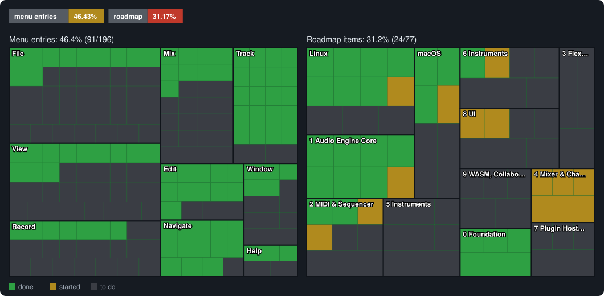

# Pro Wave Mac

**Pro Wave Mac** is a free, open-source music production program (DAW) for macOS, written in
Rust. Its look and workflow follow Apple's Logic Pro; it hosts your Audio Unit and VST3
plug-ins and adds tools of its own. It is drawn with [egui](https://github.com/emilk/egui):
no Electron, no JUCE.

It is the public edition of a personal fork of [Pro Wave](https://github.com/fabox-os/Pro-Wave)
(GPL-3.0). It runs on macOS 11 or later, on Apple silicon and Intel Macs.

> **Status:** early development. Expect missing features and rough edges; save often.

## What it does

- **Plug-ins:** Audio Unit and VST3 instruments and effects, with their own windows.
- **Automation** in the style of Ableton Live: automation mode, draw mode, arm, lanes per
  parameter, for the mixer, the built-in effects and plug-ins.
- **Native effects:** Lemon Limiter, Press (multiband maximiser), Lemon Transient Processor,
  Lemon Soft Clipper, Lemon Fast Distortion (ports of Lemon Studio's open-source effects),
  plus Channel EQ, Compressor, Space Designer-style convolution reverb, Tape Delay, Chorus,
  Phaser, Overdrive, Filter, Gate, Limiter, multi-band EQ and an amp designer.
- **Channel Rack:** a step-sequenced sample rack.
- **Piano Roll** with Logic's editing commands: quantize, scale quantize, velocity lane, MIDI
  draw lanes; Score, Step and Event List editors.
- **Sampler** in the style of the SP-303: pads, banks, chop, Vinyl Sim and the other effects,
  patterns, a file browser with tempo and key.
- **Pro Wave Tune** (pitch correction, with a drawn correction lane) and the **Pitch Editor**
  (note-by-note editing of an audio region).
- **Spectrogram** view and **Paint Image to Audio**.
- **MIDI:** clock in and out, MIDI out to hardware synths, MIDI Time Code, a MIDI Monitor,
  Musical Typing (play with the computer keyboard).
- **Audio engine:** a low-latency duplex Core Audio engine (input and output in one callback),
  record and mix modes, time stretch (Signalsmith Stretch).
- **Templates:** 30 genre and artist templates made with the built-in instruments and free
  plug-ins (see [`docs/templates/README.md`](docs/templates/README.md)).

## Status

How much of the app works today, counted from the source: a menu entry is done when it can be
used, and a roadmap item when it is ticked in [`ROADMAP.md`](ROADMAP.md). Run `cargo xtask status`
to update this section.

<!-- status:start (made by `cargo xtask status`) -->


| | Done | Started | Total | Done % |
| --- | ---: | ---: | ---: | ---: |
| Menu entries | 91 | 0 | 196 | 46.43% |
| Roadmap items | 24 | 12 | 77 | 31.17% |
<!-- status:end -->

## Download

Get `ProWave-Mac.dmg` from the [Releases page](https://github.com/yuribeats/prowave/releases),
open it and drag **Pro Wave Mac** to Applications. The app checks for updates itself (Help >
Check for Updates…), using `prowave-macos-universal.zip` from the same page.

The app is ad-hoc signed, not notarized by Apple: the first time, Control-click it in
Applications, choose Open, then Open again.

## Build from source

Rust stable and Xcode's command line tools are needed.

```sh
cargo run --release -p prowave-app                  # the app
cargo run --release -p prowave-app -- song.prowave   # open a project
cargo xtask check                                    # fmt, clippy -D warnings, tests, cargo-deny, wasm check
bash dist/macos/release.sh                           # universal "Pro Wave Mac.app", the zip and the DMG
```

Settings are kept in `~/Library/Application Support/prowave-mac`.

## Workspace

| Crate | What it is |
|---|---|
| [`crates/prowave-engine`](crates/prowave-engine) | Real-time audio engine: transport, tempo map, synth, mixer, effects, plug-in hosting, disk streaming |
| [`crates/prowave-app`](crates/prowave-app) | The desktop app (egui): every view and editor |
| [`crates/prowave-project`](crates/prowave-project) | The `.prowave` project file format |
| [`xtask`](xtask) | `cargo xtask check`, `wasm-check`, `rt-check`, `bench` and `status` |

## License

Copyright (C) 2026 the ProWave contributors.

Pro Wave Mac is free software: you can redistribute it and/or modify it under the terms of the
[GNU General Public License](LICENSE) as published by the Free Software Foundation, either
version 3 of the License, or (at your option) any later version (GPL-3.0-or-later). It is
distributed in the hope that it will be useful, but WITHOUT ANY WARRANTY; without even the
implied warranty of MERCHANTABILITY or FITNESS FOR A PARTICULAR PURPOSE.

Third-party code keeps its own license: the WORLD vocoder (modified BSD,
[`crates/prowave-engine/world`](crates/prowave-engine/world)), Signalsmith Stretch (MIT) and the
Rust crates listed in `Cargo.lock`. The template one-shots are CC0.

## Trademarks

Pro Wave Mac is an independent project. It is not affiliated with, sponsored by or endorsed by
any of the companies below, and contains none of their code, artwork or sounds.

- Apple, Logic Pro, macOS and Audio Units are trademarks of Apple Inc.
- FL Studio and Fruity are trademarks of Image-Line Software.
- Ableton and Live are trademarks of Ableton AG.
- Roland, BOSS and Dr. Sample are trademarks of Roland Corporation.
- VST is a trademark of Steinberg Media Technologies GmbH.

The names are used only to describe the workflows Pro Wave Mac follows.
